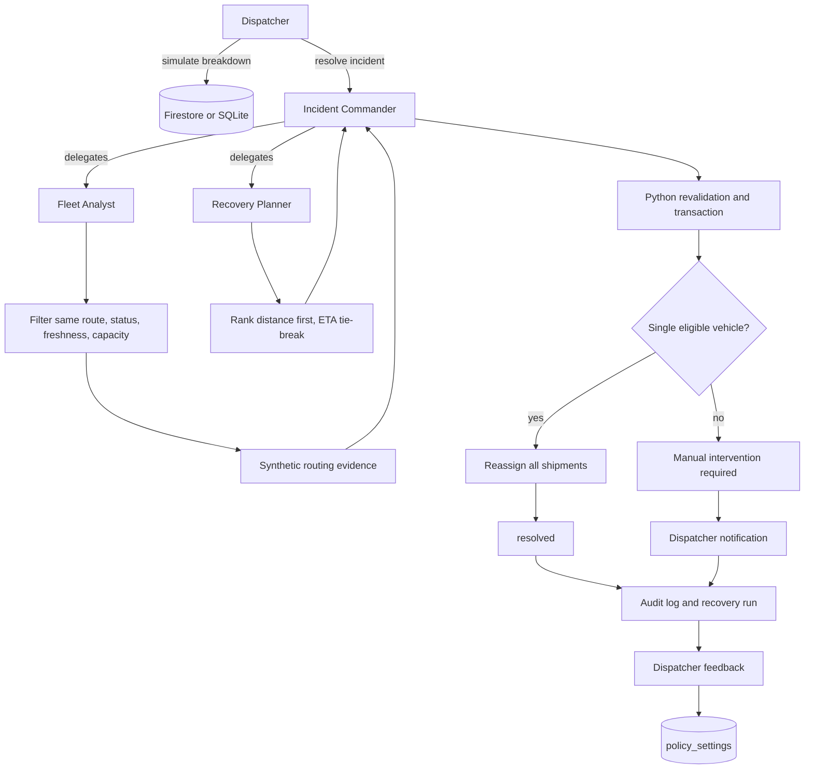
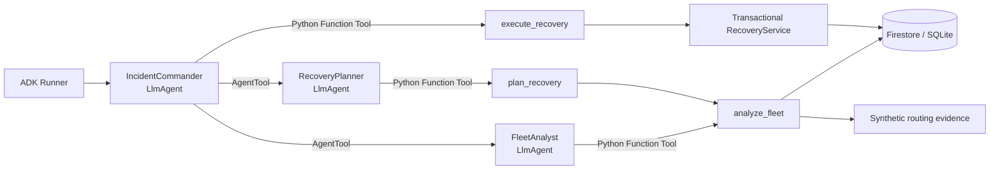

# Delivery Exception Manager

Backend-first vehicle-breakdown recovery using Python, FastAPI, Google ADK, Firebase Authentication, and Firestore. A dispatcher simulates a breakdown, then explicitly resolves it through ADK agents backed by deterministic service rules and transactional storage. There is no driver report endpoint, polling loop, or background recovery agent.

**Frontend work is paused.** Existing React/Vite frontend edits are incomplete and are not a finished dispatcher experience. The backend API and administrative CLI are the current implementation surface.

## Backend Quickstart

Run from the repository root in PowerShell. Install uv; it provisions the pinned Python version. Create the environment file only if it does not already exist:

```powershell
uv sync --directory backend --locked
if (-not (Test-Path backend/.env)) { Copy-Item backend/.env.example backend/.env }
uv run --directory backend logistics-api
```

API docs: http://127.0.0.1:8000/docs. Health: http://127.0.0.1:8000/api/health. Health reports configuration presence, not successful external connections.

The example environment uses `DATA_MODE=auto`, `ROUTING_MODE=synthetic_demo`, `GEMINI_MODEL=gemini-3.8-flash`, and `ALLOW_CLOUD_DEMO_RESET=false`. Without cloud configuration, development recovery data persists in labelled local SQLite, **not Firestore**. With cloud configuration, use a dedicated demo workspace, Firebase ID tokens, and stored dispatcher/owner membership. Use explicit `DATA_MODE=firestore` when cloud persistence must not fall back to local storage.

For an explicitly local demo, set `DATA_MODE=local_demo` in `backend/.env`, then run:

```powershell
uv run --directory backend logistics-demo seed
uv run --directory backend logistics-demo run --scenario A
uv run --directory backend logistics-demo reset
uv run --directory backend logistics-demo run --scenario B
```

`logistics-demo` is an administrator terminal tool, not a public API or an HTTP authentication bypass. Cloud seed/reset require project confirmation and additional safety checks. `run` uses the real ADK runtime and configured storage; without a Gemini key it is explicitly labelled scripted ADK, not Gemini inference. See [backend setup and API examples](backend/README.md) before using cloud commands.

## Scope And Safety

## Recovery Agent Graph



The model coordinates the workflow, but deterministic Python tools own eligibility, ranking evidence, capacity validation, transactional assignment, escalation, and audit logging. The system never splits shipments or searches another route.

### Google ADK Delegation Graph



The Commander delegates in order: `FleetAnalyst` → `RecoveryPlanner` → `execute_recovery`. When `GOOGLE_API_KEY` is configured, the agents use the configured Gemini model. Without it, the same ADK graph runs with the explicitly labelled scripted demo model.

- Synthetic routing uses deterministic coordinate math for mock distance/ETA. It makes no Maps API calls even if a key exists, and is not real road distance or driving ETA. Maps integration is deferred; the optional Routes adapter remains available.
- Recovery either reassigns all pending parcels to an eligible same-route vehicle or records `manual_intervention_required` with a simulated dispatcher notification. Duplicate resolve returns 409.
- Feedback is persisted and can make a bounded policy adjustment; it is not full reinforcement learning or model training, and does not override nearest-distance/ETA ranking.
- The recovery parcel-count ledger is separate from the existing kg-based delivery CRUD schema. Never seed recovery into a business workspace.
- Gemini and cloud credentials belong only in ignored backend configuration or external credential storage. Never put server secrets in Vite variables or commit credential files.

The exact model ID is published in Google's official cookbook and an account model GET has succeeded. Full recovery inference is not yet verified; model discovery and health checks do not prove it.

## Firebase And Tooling

For cloud Firebase, enable Authentication (Email/Password for the existing sign-in flow) and Firestore, configure matching project IDs and backend Application Default Credentials, and provision stored workspace membership. Server SDK access bypasses Firestore Security Rules; backend authorization remains mandatory. Client Firestore rules deny direct access. No setup command provisions cloud resources automatically.

Local Firebase emulators use the CLI's `demo-agent-war` project. Install Java 21+ and Bun 1.4+, install root dependencies with `bun install`, then run `bun run emulators`. Configure Auth and Firestore emulator hosts together, in development only. Details, membership setup, and cloud reset safeguards are in [backend/README.md](backend/README.md).

Legacy `logistics-mcp` / `logistics-agent`, optional evaluation/GEPA, and Langfuse tooling are separate from incident recovery and are not required for it. See the backend README and [integration setup](docs/integrations.md) for those optional integrations. Existing planning/handoff documents may describe earlier scope rather than current verification.

## Tests

```powershell
uv run --directory backend python -m unittest discover -s tests -v
```

The suite is growing; passing local tests is not evidence of live Gemini inference, live Maps routing, or end-to-end cloud operation.
