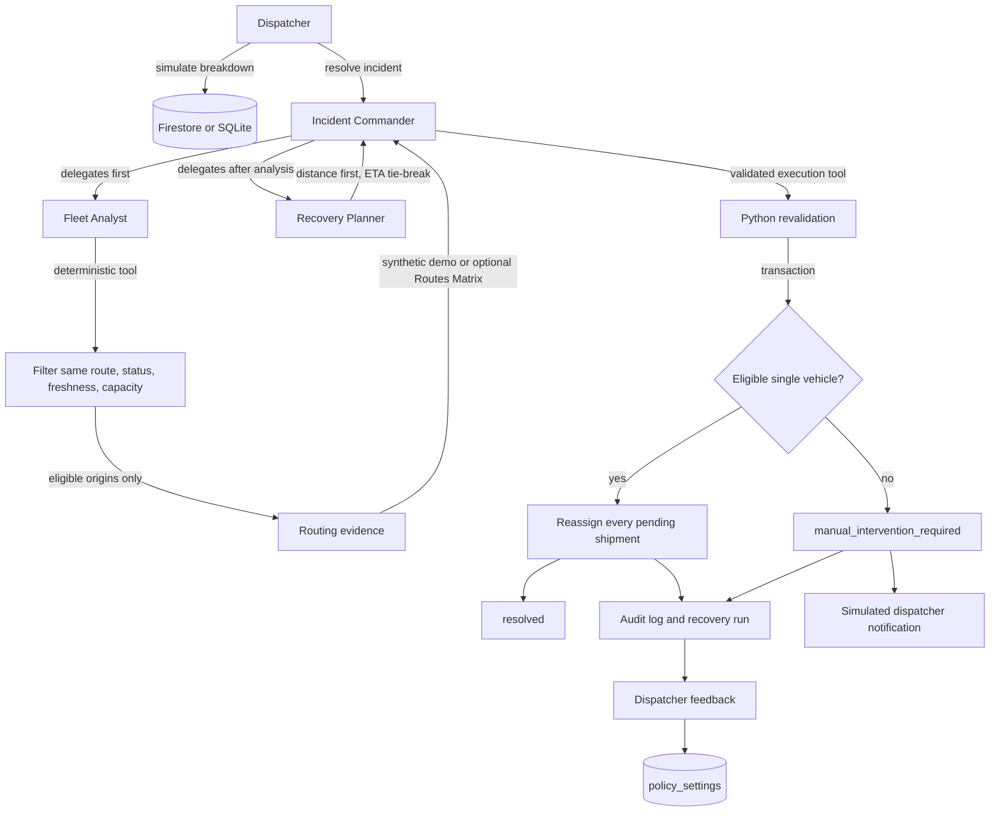
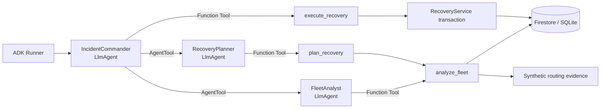

# Backend

Python 3.12, uv, FastAPI, Google ADK, Firebase Admin, and Firestore. Recovery is backend-first; **frontend development is paused**, and existing frontend edits are incomplete. Use the API or administrator CLI rather than assuming a finished browser workflow.

## Setup

Run commands from the repository root in PowerShell:

```powershell
uv sync --directory backend --locked
if (-not (Test-Path backend/.env)) { Copy-Item backend/.env.example backend/.env }
uv run --directory backend logistics-api
```

API docs: http://127.0.0.1:8000/docs. Public health: http://127.0.0.1:8000/api/health. For reload:

```powershell
uv run --directory backend uvicorn logistics_api.main:app --reload --host 127.0.0.1 --port 8000
```

Settings load from ignored `backend/.env`. Do not overwrite an existing environment file. Startup/health can succeed without initializing Firestore or the agent; health is configuration presence, not a successful connection or inference check.

Relevant `.env.example` defaults:

```dotenv
APP_ENVIRONMENT=development
DATA_MODE=auto
ROUTING_MODE=synthetic_demo
GEMINI_MODEL=gemini-3.8-flash
GEMINI_MODEL_FALLBACKS=["gemini-3.7-flash","gemini-3.6-flash","gemini-3.5-flash","gemini-flash-latest"]
ALLOW_CLOUD_DEMO_RESET=false
LOCATION_MAX_AGE_SECONDS=900
```

Keep real Gemini keys, Firebase credentials, tokens, and account-specific configuration out of documentation, source control, and frontend/Vite variables. Use `GOOGLE_API_KEY` for Gemini in backend configuration only. `gemini-3.8-flash` was selected from the live generation-model list returned for the configured API key. This does **not** verify full inference or an end-to-end recovery run; quota may still block inference.

The model discovery utility can inspect available generation models without running inference:

```powershell
uv run --directory backend logistics-models --check gemini-3.8-flash
```

## Storage Modes

- `DATA_MODE=local_demo`: development-only, persistent SQLite at `backend/.local/recovery.sqlite3`. Responses explicitly label local storage and say changes are **not written to Firestore**. Initial local recovery access seeds the demo if there are no vehicles.
- `DATA_MODE=firestore`: use configured Firebase credentials and project, with recovery scoped to `RECOVERY_WORKSPACE_ID`.
- `DATA_MODE=auto`: select local demo without cloud project/credential configuration, or when ambient ADC is unavailable in the applicable discovery branch; otherwise select Firestore. Invalid explicit credentials or cloud request failures are not a general offline fallback. Use explicit `firestore` when cloud persistence is required, or explicit `local_demo` for a deliberately offline demo.

`GOOGLE_CLOUD_PROJECT` takes precedence over `FIREBASE_PROJECT_ID`. Recovery collections are scoped beneath the configured workspace:

```text
organizations/{workspace}/vehicles
organizations/{workspace}/shipments
organizations/{workspace}/incidents
organizations/{workspace}/recovery_runs
organizations/{workspace}/recovery_feedback
organizations/{workspace}/policy_settings
organizations/{workspace}/audit_logs
```

This is a small demo store, not an unbounded production fleet datastore. Firestore mutations use transactions and a shared recovery lock; oversized mutations are refused. SQLite also applies mutations transactionally.

Recovery uses `parcel_capacity`, `assigned_shipment_ids`, and shipment counts, **not** the existing `load_kg` / `capacity_kg` delivery CRUD schema. Both use a `vehicles` collection name, so a **dedicated demo workspace is mandatory**. Do not mix these ledgers or seed an operational organization.

## Demo CLI

`logistics-demo` is an administrative terminal command using server credentials, not a public endpoint. `run` invokes the actual ADK runtime and recovery service against configured storage and prints only a sanitized run summary, not credentials, raw model output, or a workspace dump. It is not a dry run: a successful execution persists changes.

For local storage, set `DATA_MODE=local_demo` in `backend/.env`; no project confirmation is needed:

```powershell
uv run --directory backend logistics-demo seed
uv run --directory backend logistics-demo run --scenario A
uv run --directory backend logistics-demo reset
uv run --directory backend logistics-demo run --scenario B
```

Seed refuses nonempty recovery data rather than overwriting it. Use reset deliberately to repeat scenarios and refresh timestamps. Scenario A has eligible same-route capacity and should resolve; scenario B demonstrates escalation because same-route alternatives fail capacity, availability, or freshness checks. Run promptly after seeding/resetting: default location freshness is 900 seconds, and one candidate is intentionally stale.

For Firestore, configure a dedicated `RECOVERY_WORKSPACE_ID` and use the exact configured project ID for `PROJECT`. `FIREBASE_UID` is an existing Firebase Authentication user's UID, not a token or service-account identity:

```powershell
uv run --directory backend logistics-demo seed --confirm-project PROJECT --dispatcher-uid FIREBASE_UID
uv run --directory backend logistics-demo run --scenario A
uv run --directory backend logistics-demo reset --confirm-project PROJECT
uv run --directory backend logistics-demo run --scenario B
```

The optional `--dispatcher-uid FIREBASE_UID` provisions dispatcher membership for the demo workspace; omitting it does not remove the HTTP membership requirement. Cloud seed safely creates a dedicated workspace root with the `agentwars_demo_workspace` marker if absent, rejects an existing unmarked root, and refuses nonempty data. It is not a way to adopt or overwrite an existing business workspace.

Cloud reset requires **all** of: matching `--confirm-project PROJECT`, a marked demo workspace, `APP_ENVIRONMENT=development`, `ALLOW_CLOUD_DEMO_RESET=true`, and `ROUTING_MODE=synthetic_demo`. Reset is destructive to demo recovery records. Leave the allow flag false except when intentionally resetting. Reset refreshes demo locations and preserves policy by default; the API's `preserve_policy: false` also restores the default policy. Neither CLI privileges nor seed membership creation are an HTTP authentication bypass.

## Firebase Access

Enable Firestore and Firebase Authentication; enable Email/Password for the existing sign-in flow. Cloud backend access uses Application Default Credentials, or an explicit external service-account file referenced by `GOOGLE_APPLICATION_CREDENTIALS` in ignored backend configuration. Keep credential files outside the repository. The existing root helper `bun run setup:firebase-admin` can validate an external credential file and store only its path; restart the backend after changing configuration. No setup step here automatically provisions cloud resources.

Every cloud recovery request requires `Authorization: Bearer <Firebase ID token>` and a stored `owner` or `dispatcher` role at `organizations/{RECOVERY_WORKSPACE_ID}/members/{uid}`. The backend verifies the Firebase token, including revocation, and checks membership per request. A token alone is insufficient; membership in another workspace is insufficient. There is no cloud auth bypass. Local SQLite recovery is an explicitly unauthenticated development demo, not a production mode.

`GET /api/me` returns the authenticated identity and memberships using the private `users/{uid}` workspace index. `POST /api/workspaces` idempotently creates the user's ordinary owner workspace, but does not replace provisioning membership in the separately configured recovery demo workspace. Its JSON body is:

```json
{
  "name": "My depot"
}
```

Server SDKs bypass Firestore Security Rules, so backend membership enforcement is essential. Client rules deny direct access. Do not expose developer servers or emulator authentication to production.

For emulators, install Java 21+ and root Bun dependencies, then run:

```powershell
bun run emulators
```

The Firebase CLI defaults to local project `demo-agent-war`; match project IDs across clients and backend. Configure **both** hosts together:

```dotenv
APP_ENVIRONMENT=development
DATA_MODE=firestore
FIREBASE_PROJECT_ID=demo-agent-war
FIRESTORE_EMULATOR_HOST=127.0.0.1:8080
FIREBASE_AUTH_EMULATOR_HOST=127.0.0.1:9099
```

Emulator UI: http://127.0.0.1:4000. Emulator overrides are rejected outside development; mixing emulator Auth with cloud Firestore is rejected. Cloud use requires clearing both overrides, including inherited process environment values. Emulator storage is labelled separately from cloud storage.

## Recovery API

The workflow is dispatcher-triggered: simulate first, then explicitly resolve. There is **no driver report endpoint, polling, or background agent**. These endpoints use the configured recovery workspace, not an organization ID supplied by a caller.

### Multi-Agent Graph



The model never receives authority to invent fleet records, select arbitrary IDs, bypass capacity, choose another route, split shipments, or write Firestore directly. The Fleet Analyst and Planner are ADK-delegated roles, while `analyze`, `plan`, and `execute` are server-bound deterministic Python tools. The execution transaction rechecks the incident, shipment ledger, candidate fleet snapshot, freshness, capacity, and routing origin before writing.

The ADK-specific delegation is:



- `GET /api/dashboard`: fleet, shipments, incidents, persisted runs, feedback, audit logs, policy, counts, and explicit storage/agent/routing labels.
- `POST /api/incidents/simulate`: create a breakdown for scenario A or B; returns the existing open incident if already simulated.
- `POST /api/incidents/{incident_id}/resolve`: run ADK analysis, planning, and transactional execution. No request body is needed.
- `POST /api/recovery-runs/{run_id}/feedback`: record one feedback entry per run; duplicates return 409.
- `POST /api/demo/reset`: refresh demo data, preserving policy by default. Cloud access still requires token, membership, and the marked-workspace development reset safeguards.

Simulation body:

```json
{
  "scenario": "A"
}
```

Negative feedback body (`reason` may be `too_far`, `poor_eta`, `other`, or omitted):

```json
{
  "rating": "needs_improvement",
  "reason": "too_far"
}
```

Positive feedback must not include a negative reason:

```json
{
  "rating": "good"
}
```

Default-policy-preserving reset body:

```json
{
  "preserve_policy": true
}
```

For a full demo reset including default policy:

```json
{
  "preserve_policy": false
}
```

Example PowerShell cloud flow using a Firebase ID token supplied privately in the process environment:

```powershell
$base = "http://127.0.0.1:8000/api"
$headers = @{ Authorization = "Bearer $env:FIREBASE_ID_TOKEN" }
$incident = Invoke-RestMethod -Method Post -Uri "$base/incidents/simulate" -Headers $headers -ContentType "application/json" -Body '{"scenario":"A"}'
$run = Invoke-RestMethod -Method Post -Uri "$base/incidents/$($incident.incident_id)/resolve" -Headers $headers
Invoke-RestMethod -Method Post -Uri "$base/recovery-runs/$($run.run_id)/feedback" -Headers $headers -ContentType "application/json" -Body '{"rating":"good"}'
```

Do not print, commit, or place tokens in shared command history. Local SQLite requests do not need the authorization header. Unexpected JSON fields are rejected.

### Rules And Outcomes

ADK's `IncidentCommander` calls `fleet_analyst`, then `recovery_planner`, then execution. Tools are bound server-side to an incident; the model cannot choose arbitrary assignment IDs. With `GOOGLE_API_KEY`, these are Gemini agents. Without it, a labelled `adk_scripted_demo` model emits actual ADK tool calls without claiming inference. Recovery has a bounded invocation and timeout; it does not require the legacy MCP server.

Python filters candidates before routing: same route, operational, valid fresh coordinates, consistent assignment ledger, and enough spare parcel capacity for **all** pending shipments. Rejected and other-route vehicles are never sent to the routing adapter. Ranking is lexicographic: distance first, ETA tie score second, vehicle ID last. Execution recomputes the plan, rechecks fleet and shipment state, rejects stale analysis, and commits assignments and audits together.

There are two final outcomes:

- `resolved`: all pending shipments are reassigned and vehicle ledgers updated.
- `manual_intervention_required`: no successful eligible route candidate; no shipments reassigned, and a **simulated** dispatcher notification is recorded in the audit log. This is not an external messaging integration.

A completed incident cannot be resolved again: duplicate resolve returns 409 without repeating assignments. Concurrent/stale fleet or incident changes also return conflicts. If execution persisted but the ADK final response failed, the returned persisted result may include a warning; do not blindly repeat assignments. Refresh the dashboard after ambiguous failures.

Feedback is stored, not model training. Only `needs_improvement` + `too_far` on a run with a selected vehicle increases `distance_weight` by 0.05, capped at 0.90, adjusts `eta_weight`, and versions/audits an actual policy change. `good`, `poor_eta`, and `other` do not change weights. The weights scale ETA tie scores but **do not override lexicographic distance/ETA ordering**. Positive bounded scaling does not change which ETA wins a distance tie; do not claim this feedback changes the selected winner, learns a new routing policy, or performs full RL.

## Routing Boundaries

Maps is explicitly deferred for the current demo. `.env.example` sets `ROUTING_MODE=synthetic_demo`: deterministic coordinate math produces mock distance and ETA with no API calls, **even if a Maps key exists**. This is neither road distance nor a real driving ETA and does not account for traffic, road access, or road networks.

The optional adapter remains implemented: `ROUTING_MODE=google_maps` plus a backend Maps key uses Routes API `computeRouteMatrix` for eligible origins to the breakdown location. Keys are read from `GOOGLE_MAPS_API_KEY` or `GOOGLE_MAPS_SERVER_API_KEY`. Configured provider failures remain unavailable evidence and can cause escalation; there is **no silent synthetic/straight-line fallback**. No live Maps verification is claimed.

With routing mode `auto` and no key, the adapter provides a labelled `straight_line` distance with no driving ETA. Such evidence can authorize assignments **only in local demo storage**, not Firestore. It is separate from the explicit synthetic-demo mode. Optional Maps API enablement, billing, key restrictions, and separate browser/server keys are described in [integration setup](../docs/integrations.md).

## Existing CRUD

The authenticated kg-based foundation remains available independently of recovery:

- `GET /api/organizations/{org_id}/deliveries` and `/vehicles`: paginated `{items,next_cursor}`, `limit` 1-100, optional returned `cursor`.
- `POST` either collection: create an unassigned operational record.
- `PUT /api/organizations/{org_id}/{deliveries|vehicles}/{id}`: full replacement fields plus current `version`; stale writes return 409.
- `DELETE` the record with `?expected_version=1`: stale deletes return 409.

Delivery fields are `customer_name`, `address`, `load_kg`, optional paired coordinates, optional paired timezone-aware `window_start`/`window_end`, and `status` (`pending`). Vehicle fields are `registration`, `driver_name`, `capacity_kg`, `available`, and optional paired coordinates. Backend owns IDs, organization, timestamps, versions, and roles. Unexpected fields are rejected; registration uniqueness is not enforced. Owner/dispatcher membership is required; drivers have no operational access. The CRUD API is not a shipment dispatch integration and must not be pointed at the dedicated recovery ledger.

## Legacy MCP

These setup tools are **separate from recovery**, which calls scoped Python service tools directly. They cannot mutate deliveries or recover incidents. In separate terminals:

```powershell
uv run --directory backend logistics-mcp
uv run --directory backend logistics-agent "Check which services are configured"
```

The loopback-only, unauthenticated MCP server exposes Streamable HTTP at http://127.0.0.1:8001/mcp with `get_service_status`, `geocode_address`, and `compute_route`. Its Maps tools are independent of synthetic recovery routing and can make provider calls when configured. Add authentication before remote exposure. `create_agent()` uses `McpToolset` / `StreamableHTTPConnectionParams`. The CLI owns an ADK App, runner, in-memory session, and MCP cleanup; there is no public chat endpoint or durable conversation store.

`LogisticsRecoveryPlugin` here means **tool-call correction**, not the incident recovery workflow. It detects structured MCP errors and exceptions, defaults to two retries (`AGENT_TOOL_MAX_RETRIES`, range 0-5), and passes nonretryable errors through for escalation. The legacy CLI bounds calls with `AGENT_MAX_LLM_CALLS` (default 12, maximum 30). ADK CLI/web runners use `ADK_MAX_LLM_CALLS` instead.

Optional local ADK UI, from `backend/`:

```powershell
uv run adk web agents --host 127.0.0.1 --port 8002
```

This is a developer tool, not an authenticated dispatcher frontend.

## Optional Evaluation

Evaluation/GEPA and Langfuse are **not required for recovery**. From `backend/`, with legacy MCP and Gemini configured:

```powershell
uv sync --extra eval
uv run --extra eval adk eval agents/dispatcher agents/dispatcher/train.evalset.json --config_file_path evaluation/test_config.json
uv run --extra eval adk eval agents/dispatcher agents/dispatcher/heldout.evalset.json --config_file_path evaluation/test_config.json
uv run --extra eval adk optimize agents/dispatcher --sampler_config_file_path evaluation/sampler.json --optimizer_config_file_path evaluation/optimizer.json --print_detailed_results
```

These make paid model calls, and route cases may call Maps. Existing datasets target legacy setup/tool trajectories, not certification of incident recovery, factual answers, or safety. GEPA prints candidate root-agent instructions and writes intermediate artifacts to `artifacts/optimization`; it does not activate prompts, edit source, optimize runtime plugins, or train model weights. Review candidates and evaluate heldout data before accepting through code review. A metric-call budget is not a dollar-cost guarantee.

Earlier Windows setup encountered `WinError 5` building optional `rouge-score` metadata. Evaluation/GEPA execution has not been verified; retry optional installation in a normal terminal if needed.

For optional trace export, install `uv sync --extra observability` from `backend/` and configure `LANGFUSE_ENABLED=true`, `LANGFUSE_PUBLIC_KEY`, `LANGFUSE_SECRET_KEY`, and `LANGFUSE_BASE_URL` privately in backend configuration. Disabled by default, it initializes no exporter. Legacy runtime instrumentation can export prompts, addresses, and tool arguments; use synthetic data until retention and access policies are established. Do not assume all recovery invocations are instrumented merely because the extra is installed.

To annotate an existing trace, from `backend/`:

```powershell
uv run --extra observability logistics-feedback YOUR_TRACE_ID --score 0 --comment "The destination needs clarification."
```

This credentialed terminal command annotates a trace, not the recovery policy. It neither trains the model nor updates prompts automatically, and exposes no unauthenticated HTTP feedback endpoint.

## Verification And Source

```powershell
uv run --directory backend python -m unittest discover -s tests -v
```

Tests are being added; no fixed final count or live-service certification is implied. Local unit/API tests, successful model metadata lookup, and health configuration checks are not proof of full Gemini inference, live Maps accuracy, or end-to-end cloud operation.

Key source modules under `src/logistics_api/`:

- `config.py`, `firebase.py`: settings, lazy credentials, paired development-only emulator guards.
- `recovery_api.py`: storage selection, cloud authorization, endpoint payloads.
- `recovery.py`: seed data, eligibility, lexicographic ranking, transactional execution, reset and bounded feedback policy.
- `recovery_agents.py`: real ADK orchestration, Gemini/scripted distinction, execution result handling.
- `recovery_maps.py`: synthetic math, straight-line estimates, optional Routes matrix adapter.
- `recovery_store.py`: labelled persistent SQLite and Firestore transaction implementations.
- `operations.py`: Firebase token verification, membership, workspace bootstrap, separate kg-based CRUD.
- `models_cli.py`: model discovery; `agent.py`, `agent_runtime.py`, `mcp_server.py`, `maps.py`, `observability.py`: legacy agent/MCP and optional telemetry.

References: [Firebase Admin setup](https://firebase.google.com/docs/admin/setup), [emulator client setup](https://firebase.google.com/docs/emulator-suite/connect_firestore), [ADK tools](https://google.github.io/adk-docs/tools-custom/), [ADK evaluation](https://google.github.io/adk-docs/evaluate/), [Gemini cookbook](https://github.com/google-gemini/cookbook), and [Langfuse ADK integration](https://langfuse.com/integrations/frameworks/google-adk).
